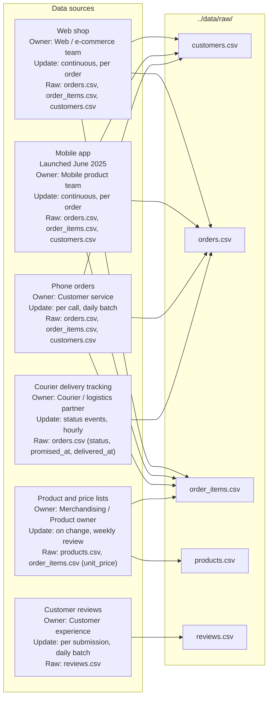

# Sweet Layers data sources

Owners and update cadences are stated from the system/team responsible for each source. In this repository the same CSVs are stored under `Assignment 01/` and `Assignment 02/`; the diagram uses the requested `../data/raw/` labels.
