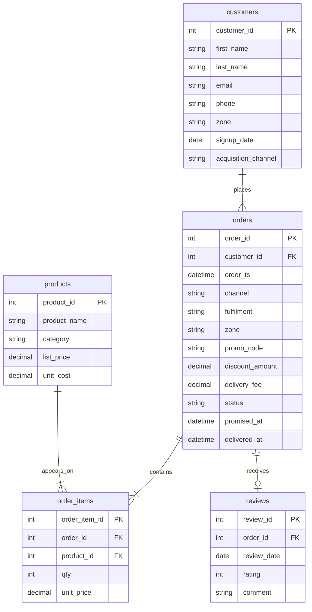

# Sweet Layers ERD — verified with SQL



## Keys

| Table | PK | FK | FK references |
|---|---|---|---|
| `customers` | `customer_id` | — | — |
| `orders` | `order_id` | `customer_id` | `customers.customer_id` |
| `order_items` | `order_item_id` | `order_id`, `product_id` | `orders.order_id`, `products.product_id` |
| `products` | `product_id` | — | — |
| `reviews` | `review_id` | `order_id` | `orders.order_id` |

Schema corrections from Step 6: the file is `order_items.csv`, not `orders_items.csv`; its key is `order_item_id`, not `order_item`; the orders FK is `customer_id`, not `customer_order`; the delivery timestamp is `delivered_at`, not `delivery-T`. `zone` is a text attribute in `customers` and `orders` — there is no `zones` table and no FK to one.

## Cardinality checks (SQLite SQL)

These queries assume the CSVs were imported as tables named `customers`, `orders`, `order_items`, `products` and `reviews`. The full runnable script is `erd-cardinality-checks.sql`.

Row counts: `customers` 3,404; `orders` 6,075; `order_items` 10,071; `products` 19; `reviews` 1,561.

Key checks: duplicate PKs = 0 and null PKs = 0 for all five tables.

### 1. `customers ||--|{ orders`

```sql
SELECT COUNT(*) AS orphan_or_null_fk
FROM orders o
LEFT JOIN customers c ON o.customer_id = c.customer_id
WHERE c.customer_id IS NULL OR o.customer_id IS NULL OR TRIM(COALESCE(CAST(o.customer_id AS TEXT), '')) = '';

SELECT MIN(n) AS min_orders_per_customer, MAX(n) AS max_orders_per_customer
FROM (SELECT customer_id, COUNT(*) AS n FROM orders GROUP BY customer_id) AS x;

SELECT COUNT(*) AS customers_with_zero_orders
FROM customers c
LEFT JOIN orders o ON c.customer_id = o.customer_id
WHERE o.order_id IS NULL;
```

Results: `0` orphan/null FK; `1`–`9` orders per customer; `0` customers with zero orders. Every order has exactly one customer, and every customer in this extract has at least one order, so the observed cardinality is **one-or-many** (`|{`). If the business model must allow new customers before their first order, use `o{` instead.

### 2. `orders ||--|{ order_items`

```sql
SELECT COUNT(*) AS orphan_or_null_fk
FROM order_items i
LEFT JOIN orders o ON i.order_id = o.order_id
WHERE o.order_id IS NULL OR i.order_id IS NULL OR TRIM(COALESCE(CAST(i.order_id AS TEXT), '')) = '';

SELECT MIN(n) AS min_items_per_order, MAX(n) AS max_items_per_order
FROM (SELECT order_id, COUNT(*) AS n FROM order_items GROUP BY order_id) AS x;

SELECT COUNT(*) AS orders_with_zero_items
FROM orders o
LEFT JOIN order_items i ON o.order_id = i.order_id
WHERE i.order_item_id IS NULL;
```

Results: `0` orphan/null FK; `1`–`4` items per order; `0` orders with zero items. Therefore **one-or-many** (`|{`).

### 3. `products ||--|{ order_items`

```sql
SELECT COUNT(*) AS orphan_or_null_fk
FROM order_items i
LEFT JOIN products p ON i.product_id = p.product_id
WHERE p.product_id IS NULL OR i.product_id IS NULL OR TRIM(COALESCE(CAST(i.product_id AS TEXT), '')) = '';

SELECT MIN(n) AS min_items_per_product, MAX(n) AS max_items_per_product
FROM (SELECT product_id, COUNT(*) AS n FROM order_items GROUP BY product_id) AS x;

SELECT COUNT(*) AS products_with_zero_items
FROM products p
LEFT JOIN order_items i ON p.product_id = i.product_id
WHERE i.order_item_id IS NULL;
```

Results: `0` orphan/null FK; `104`–`1,303` item rows per product; `0` products with zero items. Therefore **one-or-many** (`|{`). If unsold products must be allowed in the model, use `o{`.

### 4. `orders ||--o| reviews`

```sql
SELECT COUNT(*) AS orphan_or_null_fk
FROM reviews r
LEFT JOIN orders o ON r.order_id = o.order_id
WHERE o.order_id IS NULL OR r.order_id IS NULL OR TRIM(COALESCE(CAST(r.order_id AS TEXT), '')) = '';

SELECT MIN(n) AS min_reviews_per_order, MAX(n) AS max_reviews_per_order,
       SUM(CASE WHEN n > 1 THEN 1 ELSE 0 END) AS orders_with_multiple_reviews
FROM (SELECT order_id, COUNT(*) AS n FROM reviews GROUP BY order_id) AS x;

SELECT COUNT(*) AS orders_with_zero_reviews
FROM orders o
LEFT JOIN reviews r ON o.order_id = r.order_id
WHERE r.review_id IS NULL;
```

Results: `0` orphan/null FK; `1` review minimum and maximum; `0` orders with more than one review; `4,514` orders with no review. Therefore **zero-or-one** review per order (`o|`).
